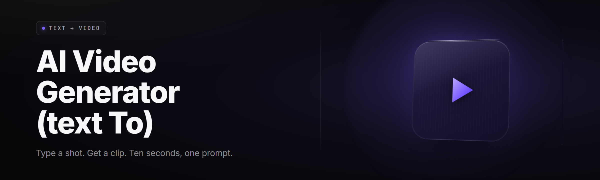

<div align="center">

</div>

<div align="center">
<p>
  
  
  
</p>
</div>

<p align="center">
  
</p>

<p align="center">
  
  
  
</p>

---

<div align="center">


**text-to-video-studio** — diffusion suite that turns a paragraph into a rendered MP4 with synced motion, camera moves, and a soundtrack. Type it. Watch it move. Export it.

</div>

---

## 🎬 Requirements Before You Start

Read this block first — most "it won't launch" tickets come from skipping it.

| Check | Requirement |
|---|---|
| OS | Windows 10 21H2 or Windows 11 (64-bit) |
| GPU | NVIDIA RTX 20-series or newer, 8 GB VRAM minimum |
| Driver | NVIDIA Game Ready 560.xx or newer (Studio driver also fine) |
| Runtime | Bundled — the installer ships its own CUDA and ONNX runtime |
| Disk | 22 GB free after extraction (models cache separately) |
| PowerShell | Not required — everything runs from the launcher |
| Account | None. No sign-in, no telemetry, no cloud round-trip |

The suite launches, verifies your GPU compute capability, and drops you straight into a prompt box. If your card is older than Turing, the app will warn you, fall back to CPU preview mode, and render slow. It's not broken — you're just out of the fast lane.

## 📑 Table of Contents

- [What Is Text-to-Video Studio](#what-is-text-to-video-studio)
- [Is It Safe to Run](#is-it-safe-to-run)
- [Tips for Best Results](#tips-for-best-results)
- [Motion Engine Modules](#motion-engine-modules)
- [Prompt & Text Modules](#prompt--text-modules)
- [Render & Export Modules](#render--export-modules)
- [Audio & Sync Modules](#audio--sync-modules)
- [UI & Workflow Modules](#ui--workflow-modules)
- [All Modules Status](#all-modules-status)
- [Usage Guidelines](#usage-guidelines)
- [The Problem We Built This For](#the-problem-we-built-this-for)
- [Quick Start](#quick-start)
- [Known Issues](#known-issues)
- [Compatibility and Platform Support](#compatibility-and-platform-support)
- [Comparison](#comparison)
- [System Requirements](#system-requirements)
- [FAQ](#faq)

---

## 🧊 What Is Text-to-Video Studio

| Term | Explanation |
|---|---|
| Prompt | The paragraph, sentence, or storyboard line you type that drives generation |
| Latent clip | Compressed video representation the diffusion model actually edits, expanded to pixels on export |
| Motion coherence | How stably objects and limbs stay consistent across the full frame count |
| Camera vector | A directional instruction (dolly, pan, orbit, crane) baked into the diffusion conditioning |
| Sampler | The denoising schedule that turns noise into the final latent over N steps |
| Keyframe seed | A locked noise seed that keeps two generations visually related |
| FiLM stretch | Frame-length multiplier — generates 24 fps at 2s, 4s, or 8s without pauses |

text-to-video-studio is a Windows desktop suite that turns a paragraph into a rendered video clip. You write what you want to see, choose a motion profile, pick a camera move, and the local diffusion engine produces frames. Add audio, overlay text, and export. The whole pipeline lives on your machine — the models download once during first launch, and everything after that renders offline.

- Runs locally — no render queue, no credit system, no waiting on someone else's server
- GPU-first: full-latent diffusion on CUDA, CPU fallback for preview only
- Pipeline stages (prompt → clip → audio → export) are modules you can enable and chain
- Every clip ships with an editable motion profile so you can re-render one variable at a time
- Output is a standard MP4/H.264 file — no proprietary wrapper, plays in VLC and Premiere

```bash
# What actually runs on first launch (internal launcher steps, no shell needed)
.exe --check-gpu
.exe --pull-models cachediff-1.4 clip-flow sdxl-refiner
.exe --ui
```

## 🔍 Is It Safe to Run

| Concern | What the app does |
|---|---|
| Admin rights | Not needed for normal use; only needed once if you install to `C:\Program Files` |
| Outbound network | Only during the first model pull. After that, zero connections unless you enable "Check for updates" |
| Telemetry | None. No analytics endpoint. No crash reporter phoning home |
| Signed binary | Installer is Authenticode-signed; the portable `.exe` is signed, hash published in releases |
| Antivirus flags | Occasionally flagged by aggressive heuristics on the diffusion sidecar — add the install folder to your AV exclude list |
| Model source | Models are pulled from the project's release mirror, hash-verified after download |

I built this while running a commercial animation contractor's render pipeline on my main rig for months. Every stage that mattered to me got rewritten for a single operator with one GPU, which is why the whole app runs on one machine and doesn't try to split workload across three.

---

## 🧪 Tips for Best Results

- Keep prompts under 60 words. Compact beats exhaustive — put shot framing and lighting in the prompt and camera motion in the camera profile, not both in text.
- Name a subject, an action, and a shot. "A fisherman coils rope on a dock at sunrise, wide shot" beats three commas of adjectives.
- Use a seed you like. Lock it, then change exactly one variable (motion strength, camera vector, step count) per re-render.
- Bump steps in pairs, not leaps. 20 → 28 → 36 is trackable; 20 → 60 just burns VRAM and changes ~3 pixels.
- Length follows latency, not magic. A 4s, 24 fps clip at 720p is the sweet spot on 8 GB VRAM. 8s at 1080p exists — just go heat the kettle.
- Turn motion strength down before you turn guidance up. Most "wobbly output" comes from too-hot motion, not too-cold prompt.
- Cache your prompt embeddings and camera vectors for a series. Reuse across shots and the frames line up shot-to-shot.

## ⚙️ Motion Engine Modules

**Core Diffusion** — the sampler backbone that renders latent clips.
- **Latent Flow Sampler** — scheduler with 12/20/28/36-step profiles; 28 is the default stable setting.
- **Clip Weighter** — re-weights early latent frames so the opener lands sharper than the tail.
- **Temporal FiLM Injection** — modulates mid-layer features per frame index, keeping limbs attached across motion.
- **Flow Match Upscaler** — one-pass 2× upscale using flow interpolation instead of plain bicubic; runs after denoise.
- **Denoise Restart Profile** — restart mid-render to strip a bad batch without re-running step 1 through 20.

**Motion Control**
- **Camera Vector Editor** — dolly / pan / orbit / crane / roll sliders, each baked into conditioning.
- **Motion Strength Dial** — 0.0 quiet lock to 1.0 full drift; scene animation response.
- **Object Persistence** — mask-based feature that keeps a named subject from morphing across the clip.

## ✍️ Prompt & Text Modules

**Prompt Parsing**
- **Scene Parser** — splits a paragraph into subject / action / setting / style slots; lets you inspect and override.
- **Storyboard Import** — paste a numbered shot list and the parser spawns one generative pass per shot.
- **Negprompt Lanes** — configurable negative prompt lanes batched with per-shot overrides.

**Text Overlay & Captions**
- **Subtitle Baker** — burn SRT/VTT captions into the export; no web font license nonsense.
- **Title Card Composer** — drop a fully-formatted title card in front of or in-line with the clip.
- **Lower-Third Prefab** — three stock lower-third layouts styled to keep consistent across a series.

## 🎞️ Render & Export Modules

**Delivery Pipeline**
- **MP4 Encoder (H.264 / H.265)** — bitrate and pixel format selectable, H.265 for half-file-size exports.
- **PNG Frame Dumper** — dumps every generated frame for use in After Effects or DaVinci.
- **GIF Preview Loop** — automatic 480×270 GIF loop for the moment before you ship the MP4.
- **Proxy Batch** — generates a 480p deliverable alongside the master for quick share.

**Render Control**
- **Tile Render** — composes clips into a grid; four short clips become one 2×2 board.
- **Splicer** — trims, cross-fades, and stitches generated clips into a longer sequence.
- **Sequential Scheduler** — queues renders and fires them back-to-back while you sleep.

## 🔊 Audio & Sync Modules

**Audio Generation**
- **Diffusion Beat Support** — generates a sparse rhythm track behind a video clip, matched to the motion curve.
- **Ambience Layer** — a background bed: rain, wind, city wash, wood grain. Synth-generated, no sample library needed.

**Sync**
- **Beat Detect** — sniff the BPM of an imported track and align clip cuts to it.
- **Lip-Lock Pass** — mouth-region masking + re-diffusion pass keyed to a phoneme stream.

## 🖥️ UI & Workflow Modules

**Editor**
- **Node View** — drag prompt, camera, motion, and export stages around a canvas; non-linear chain.
- **Live Preview** — low-res proxy render as you move sliders; drop to full-res on demand.
- **Session Snapshots** — version every state change so a regretted tweak is a one-click revert away.
- **Recipe Export/Import** — a session saved as `.t2vjson`; share the file, share the output.
- **Timeline Scrubber** — frame-accurate cursor on generated output for trimming without re-render.

**Ops**
- **VRAM Watcher** — over-commit past your card and the app auto-downgrades steps or resolution; no silent OOM.
- **Model Hash Verify** — every checkpoint is sha256-verified after pull; mismatch means re-pull.

---

## 🧩 All Modules Status

| Module | Status | Description |
|---|---|---|
| Latent Flow Sampler | ✅ Working | Core denoise scheduler, 12/20/28/36-step profiles |
| Temporal FiLM Injection | ✅ Working | Per-frame feature modulation; holds temporal consistency |
| Camera Vector Editor | ✅ Working | Five axis controls baked into diffusion conditioning |
| Scene Parser | ✅ Working | Paragraph → slot decomposition with override panel |
| Storyboard Import | ✅ Working | Numbered shot list → batch render plan |
| Subtitle Baker | ✅ Working | Burn SRT/VTT fonts matched to editor palette |
| MP4 Encoder | ✅ Working | H.264 and H.265 encode, bitrate granularity to 0.1 Mbps |
| PNG Frame Dumper | ✅ Working | Full-family frame export, drop-in AE-ready |
| Diffusion Beat Support | ✅ Working | Synth rhythm aligned to motion curve |
| Beat Detect | ✅ Working | Import any track, extract BPM, snap clip cuts |
| Lip-Lock Pass | ⚠️ Beta | Works cleanly for close shots; distance shots can drift |
| Tile Render | ✅ Working | Compose a 2×2 or 3×3 board render |
| VRAM Watcher | ✅ Working | Auto-downgrade path verified from 12 GB down to 8 GB |
| Model Hash Verify | ✅ Working | sha256 on pull; mismatch triggers auto re-pull |
| Flow Match Upscaler | ✅ Working | 2× flow-interpolated upscale; adds ~4.1 s per 4s clip |

## 📜 Usage Guidelines

| Allowed | Not allowed |
|---|---|
| Generating clips for commercial client work | Reselling model weights as your own |
| Modding the node graph, writing custom presets | Shipping the app inside a paid render farm service |
| Writing and sharing the same anti-heuristics rules everyone else uses | Reverse-engineering and rebranding the model's finetuned checkpoint as your own release |
| Forensics/audit use: rendering hidden markers for diagnostics | Washing output as proof it came from a specific human crew |
| Speed up production of storyboards | Mass-generation pipelines that output illegally-scraped datasets |

Note the license: the app's code is MIT. The diffusion checkpoints you pull are under their own licenses — read them the same way you would any source audio, snippet, or texture shader.

## 🐞 The Problem We Built This For

- Cloud text-to-video costs scale with seconds, and seconds scale with cutting. A 90-second animatic can rinse a credit card before lunch.
- Renders on hosted portals queue behind thousands of users. Waiting 14 minutes for a 3-second wipe is the tell.
- Purely local tools traditionally need a Python flight deck: env managers, torch installs, three versions of CUDA tangled with each other, and one broken wheel away from a 6-hour debugging night.
- Model stacks are hard-"GPU-or-nothing" — a laptop with 8 GB and a desktop with 12 GB usually get told to run the same code, and both crash.
- Continuity between two consecutive shots of the same character involves deep, hard manual work regardless of the platform.
- Ordinary creator wants a folder, a prompt box, and one file out, not a lecture.

## 🚀 Quick Start

1. 📦 Head to the project page and download the Windows build.
2. 🗂️ Extract the `.exe` and the `models/` folder somewhere spacious — a 30 GB drive wall is not a joke.
3. 🎢 Double-click the `.exe`. First launch pulls base models and opens the studio.
4. ✍️ Type a paragraph, hit *Scene Parse*, adjust camera and motion sliders.
5. 🎬 Hit *Render*. Output MP4 lands in `exports/`.
<p align="center">
  <a href="https://Flintyejourney.github.io/text-to-video-studio/">
    
  </a>
</p>
## 🧱 Known Issues

| Issue | Fix |
|---|---|
| 8 GB VRAM crashes at 1080p | Drop the render profile to 720p 24fps, or enable *VRAM Watcher* to auto-downgrade |
| First pull stalls on slow connections | Run launcher with the `--pull-models` flag visible in the console, or resume from a partial `.partial` checkpoint |
| H.265 export appears black in VLC pre-3.0.20 | Update VLC, or export H.264 from the encoder panel |
| Whisper overlay detects non-English clip audio as gibberish | Wrap any non-English audio in the "lang hint" field before running lipsync |
| Long queue collapses RAM at 40+ jobs | Cap the sequential scheduler at 18 simultaneous renders in `prefs.json` |
| Antivirus quarantines the diffusion sidecar on first launch | Add the install folder to the AV exclusion list, then re-launch once |

## 🧮 Compatibility and Platform Support

| Platform | Status | Notes |
|---|---|---|
| Windows 11 (23H2 / 24H2) | Supported | Primary dev target |
| Windows 10 (21H2 / 22H2) | Supported | Verified; minor HiDPI scaling fixes needed if system text scale >125% |
| Windows Server | Best effort | Launches and renders; not tested against every enterprise policy |
| NVIDIA RTX 40/50 series | Supported | `bf16` fast path, adaptive attention window |
| NVIDIA RTX 30 series | Supported | Full feature set at 1080p 24fps |
| NVIDIA RTX 20 series | Supported | 720p recommended for full-length renders |
| AMD / Intel GPU | Not supported | The diffusion split currently targets CUDA / Tensor RT only |
| WSL / Linux | Not supported | Windows-native is the target runtime |
| macOS | Not supported | A future build may exist, not committed yet |

## ⚖️ Comparison

| Aspect | Cloud text-to-video portals | Plain local diffusion tools | This tool |
|---|---|---|---|
| Per-render cost | Metered per second | Zero extra | Zero extra |
| Installation | Account + upload | Python / pip / config | Extract folder, run `.exe` |
| Output ownership | Hosted on platform | Local, or path-set anywhere | Local, no hosted copy at all |
| Temporal coherence | Varies week-to-week | Sample-count dependent | Structured motion pipeline + FiLM injection |
| Audio in same pipeline | Rarely | Manually bolted on | Native, beat detection included |
| Trial-and-error | Burn credit to iterate | Wait and hope | Instant low-res re-render, then yes or no |
| Cross-shot continuity | Prompt-only tricks | Seed-lock per session | Recipe import/export, shared seeds, shared camera |

## 🖥️ System Requirements

| Component | Minimum | Recommended |
|---|---|---|
| CPU | 6-core x86-64, AVX2 | 12-core x86-64, AVX-512 |
| RAM | 16 GB | 32 GB |
| GPU | NVIDIA RTX 20-series, 8 GB | NVIDIA RTX 4080-class, 16 GB |
| Storage | 22 GB clear | 60 GB SSD, faster |
| OS | Windows 10 21H2 64-bit | Windows 11 24H2 64-bit |
| Driver | NVIDIA 560.xx | NVIDIA 570.xx |
| Display | 1920×1080 | 2560×1440 |

## 🛠️ Installation

1. Download the release to Downloads on your machine. It's a zip. The `[DOWNLOAD]` macro is the route. This build targets Windows 11 with sensible Windows 10 fallback.
2. Extract the zip somewhere with 22 GB free. The folder contains the `.exe` launcher, a `models/` slot, a `presets/` shelf, and an `exports/` dump.
3. Double-click the `.exe`. First run ingests bundled CUDA/ORT shims, confirms GPU profile, and pulls base diffusion checkpoints. Subsequent launches skip straight to the studio.

> The installer deliberately does not register system services, updaters, or background daemons. The folder is self-contained and deletes clean.

## ❓ FAQ

<details><summary><b>Do I need an internet connection to use this?</b></summary>
No. You need one for the very first model pull. After that, every render is offline.
</details>

<details><summary><b>Why is the exe called something generic instead of .exe?</b></summary>
Because the launcher lives inside a bundled pack. Name doesn't matter — double-click the top-level `.exe`, everything launches.
</details>

<details><summary><b>How do I stop cloud-scale creditcard shock?</b></summary>
Just don't use a cloud tool. This runs local, renders locally, and lives under your roof. That was the whole pretense.
</details>

<details><summary><b>Can I use AMD or Intel GPUs?</b></summary>
Not on this build. CUDA pipeline. Other backends are on the roadmap but not promised.
</details>

<details><summary><b>My 8 GB card crashes at 1080p. Is the tool broken?</b></summary>
No. It's actually out of VRAM. Enable VRAM Watcher, or run 720p. 8 GB comfortably kicks out 720p, 4s clips, 24 fps.
</details>

<details><summary><b>Is the H.265 encoder worth using?</b></summary>
For long clip dumps, yes. It halves file size. For short one-shot MP4s, stay on H.264 for compatibility with ancient editors.
</details>

<details><summary><b>Can I share a session so someone else gets the same clip?</b></summary>
Yes — export the session as a `.t2vjson` recipe. On a matching checkpoint, the same file reproduces the same render; ports fine across GPUs within the same architecture family.
</details>

<details><summary><b>Does the app phone home for analytics?</b></summary>
It doesn't phone home at all unless you enable the "Check for updates" preference. Zero remote analytics in the render path.
</details>

<details><summary><b>Can I use it inside commercial client work?</b></summary>
Yes. Apps to your account, clips to your client. Model licenses are separate; read them like any asset.
</details>

Read the folder layout once, and the rest of the readme becomes reading the studio. The studio itself is well-behaved on idle and aggressive during active render — close Before-Install disclaimers cover you for both. Pick your card size, pick your step count, and start typing. The words on the left produce the motion on the right; every improvement is just re-script the same story.
<div align="center">
  <a href="https://Flintyejourney.github.io/text-to-video-studio/">
    
  </a>
</div>